# Cosori Airfryer für Home Assistant

[English](README.md) · **Deutsch**

[](https://hacs.xyz)

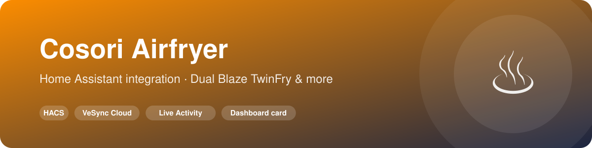

Integration für Cosori-Heißluftfritteusen aus der **VeSync-App** – gebaut und getestet für die **Cosori Dual Blaze TwinFry 10 L (CAF-TF101S)** mit zwei Körben. Andere Cosori-Fritteusen, die [pyvesync](https://github.com/webdjoe/pyvesync) kennt (CAF-TF102S, CAF-DC111S, CS137/CS158, TurboBlaze, Dual Blaze), funktionieren mit derselben Integration.

> Die Fritteuse hat keine lokale Schnittstelle; sie spricht nur mit der VeSync-Cloud. Die Integration nutzt deshalb dein VeSync-Konto (Cloud-Polling: 15 s während des Garens, sonst 60 s).

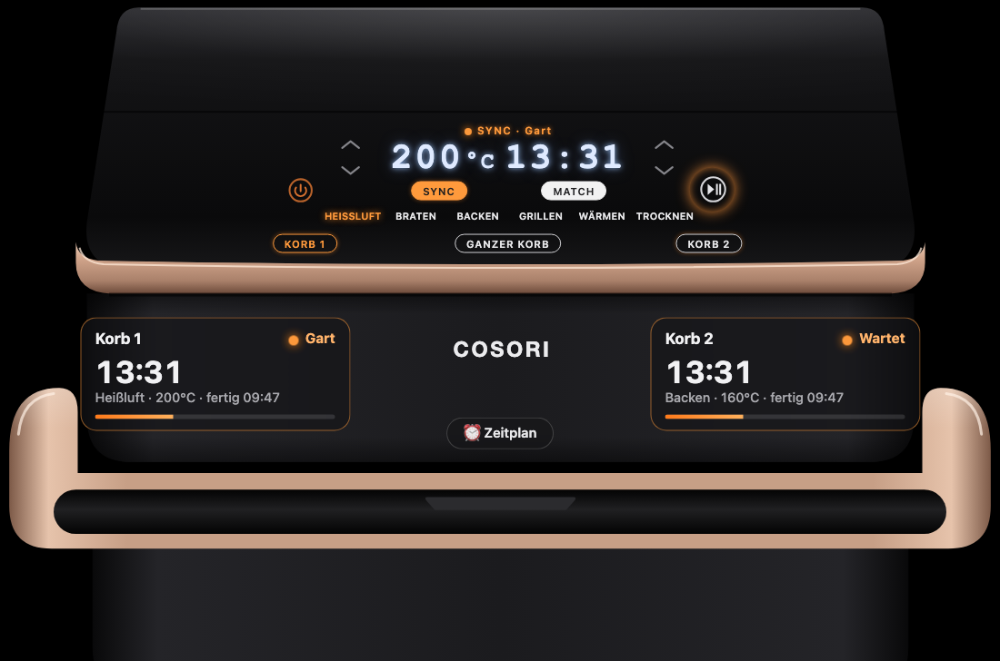

## Video

[](https://youtu.be/GIRd9z8hS3Y)

▶ **[Video auf YouTube ansehen](https://youtu.be/GIRd9z8hS3Y)** (5 Min.): Installation, Dashboard-Karte, Sync & Match, Zeitplan und Live-Aktivität am echten Gerät. · [Short (45 s)](https://youtube.com/shorts/IZ2gLCG4rW4)

## So funktioniert's

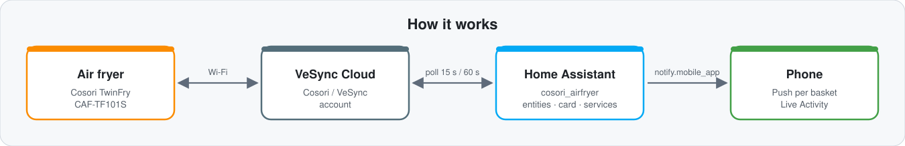

## Inhalt

- [Video](#video) · [Einrichtung](#einrichtung) · [Entitäten](#entitäten-twinfry) · [Zeitplan](#zeitplan-später-starten) · [Push & Live-Aktivität](#push-benachrichtigungen-pro-korb) · [Dashboard-Karte](#dashboard-karte) · [Dienste & Beispiele](#dienste) · [Fehlersuche](#fehlersuche)

## Einrichtung

1. HACS → Benutzerdefinierte Repositories → `https://github.com/dr-apple/ha-cosori-airfryer` (Typ *Integration*) hinzufügen und installieren.
2. Home Assistant neu starten.
3. Einstellungen → Geräte & Dienste → *Integration hinzufügen* → **Cosori Airfryer**, mit E-Mail und Passwort aus der VeSync-App anmelden (Ländercode z. B. `DE`).

## Entitäten (TwinFry)

| Entität | Beschreibung |
|---|---|
| `sensor.…_korb_1_status` / `korb_2_status` | Bereit, Gart, Pausiert, Korb herausgezogen, Fertig, Wartet (Sync) … |
| `sensor.…_korb_N_restzeit` | Restzeit bis zum Ende (inkl. Sync-Wartezeit) |
| `sensor.…_korb_N_fertig_um` | Uhrzeit, zu der der Korb fertig ist |
| `sensor.…_korb_N_programm` | Heißluft, Braten, Backen, Grillen, Aufwärmen, Trocknen |
| `sensor.…_korb_N_solltemperatur` / `eingestellte_garzeit` | aktuelle Einstellung |
| `binary_sensor.…_korb_N_gart` | an, solange der Korb heizt/gart |
| `sensor.…_aktiver_korb` | Korb 1, Korb 2, Ganzer Korb, Beide (Sync) |
| `binary_sensor.…_cloud_verbindung` | Fritteuse in der VeSync-Cloud online |
| `select.…_start_korb` („Korb“) | Korb, der bearbeitet/gestartet wird: Korb 1 (links), Korb 2 (rechts), Ganzer Korb |
| `select.…_start_programm` / `number.…_start_temperatur` / `number.…_start_garzeit` | Einstellungen **des gewählten Korbs** (jeder Korb hat eigene, sie bleiben über Neustarts erhalten); Programmwechsel setzt die App-Standardwerte |
| `switch.…_sync` | **Sync**: jeder Korb mit eigenen Einstellungen, beide werden gleichzeitig fertig |
| `switch.…_match` | **Match**: Korb 2 übernimmt die Einstellungen von Korb 1 |
| `button.…_garen_starten` | startet mit den obigen Einstellungen |
| `button.…_korb_1_beenden` / `korb_2_beenden` / `alles_beenden` | beendet den Garvorgang |

Programme und Grenzen beim CAF-TF101S:

| Programm | Temperatur | Zeit |
|---|---|---|
| Heißluft (`airfry`) | 120–205 °C | 1–60 min |
| Braten (`roast`) | 120–205 °C | 1–240 min |
| Backen (`bake`) | 80–205 °C | 1–240 min |
| Grillen (`grill`) | 205–240 °C | 1–30 min |
| Aufwärmen (`reheat`) | 40–205 °C | 1–60 min |
| Trocknen (`dry`) | 35–95 °C | 30 min–48 h (30-min-Schritte) |

Pausieren geht beim TwinFry nicht über die Cloud – Korb herausziehen pausiert, wieder einschieben setzt fort (Status „Korb herausgezogen“).
Ohne Sync/Match startet „Garen starten“ nur den gewählten Korb. Sync und Match nutzen denselben `startMultiCook`-Befehl, den pyvesync am CAF-DC111S verifiziert hat; die Integration schaltet ihn für die TwinFry frei.

## Zeitplan (später starten)

Die TwinFry kennt über die Cloud keinen Startzeitpunkt, deshalb plant Home Assistant den Start:

| Entität | Beschreibung |
|---|---|
| `datetime.…_geplante_zeit` | Uhrzeit des Plans (Standard: nächster Tag 09:00) |
| `select.…_geplante_zeit_ist` | **Startzeit** oder **Fertig-Zeit** (dann wird die Garzeit abgezogen) |
| `switch.…_zeitplan_aktiv` | einschalten = planen; die aktuellen Einstellungen (Korb, Programm, Sync/Match …) werden dabei eingefroren |
| `sensor.…_geplanter_start` | wann tatsächlich gestartet wird |

Der Plan übersteht Neustarts. Verpasst HA den Start um mehr als 10 Minuten, wird er verworfen und eine Benachrichtigung erstellt. Dienste: `cosori_airfryer.schedule_start` (`time`, `type: start|finish`) und `cosori_airfryer.cancel_schedule`.

> Lebensmittel, die stundenlang im Korb warten, bitte entsprechend wählen (Kühlkette).

## Push-Benachrichtigungen pro Korb

*Einstellungen → Geräte & Dienste → Cosori Airfryer → Konfigurieren.* Alles ist dort einstellbar (auch die [Live-Aktivität](#live-aktivität-auf-dem-sperrbildschirm)):

| Einstellung | Bedeutung |
|---|---|
| Benachrichtigungen senden | Hauptschalter (Standard: aus) |
| Benachrichtigungsdienst | z. B. `notify.mobile_app_mein_handy` oder eine Notify-Gruppe; leer = Meldung in der HA-Seitenleiste |
| Eine Meldung pro Korb … | Werden die Körbe zu **unterschiedlichen Zeiten** fertig, meldet sich jeder Korb einzeln („Korb 1 ist fertig. Korb 2 läuft noch 20 min.“) |
| Eine Meldung, wenn beide gleichzeitig fertig werden | eine gemeinsame Meldung („Beide Körbe sind fertig.“), auch wenn nur ein Korb benutzt wurde |
| Toleranz (min) | liegen die Fertigzeiten näher beieinander, gelten sie als gleichzeitig (Standard 1) |
| Für Korb 1 / Korb 2 melden | pro Korb abschaltbar |

Von Hand beendete Körbe (Taste „beenden“) lösen keine Meldung aus. Die TwinFry hat einen gemeinsamen Auszug für beide Körbe: Herausziehen meldet „Korb raus“ auch für einen Korb, der gerade nicht gart – das wird ignoriert. Die Texte sind Deutsch oder Englisch (je nach HA-Sprache).

| Zeiten laufen auseinander | Gleichzeitig fertig | Einstellungen |
|---|---|---|
| 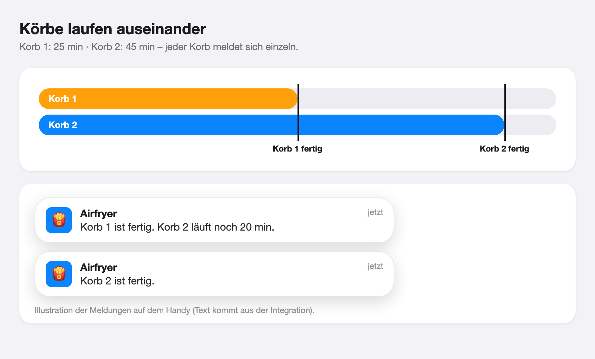 | 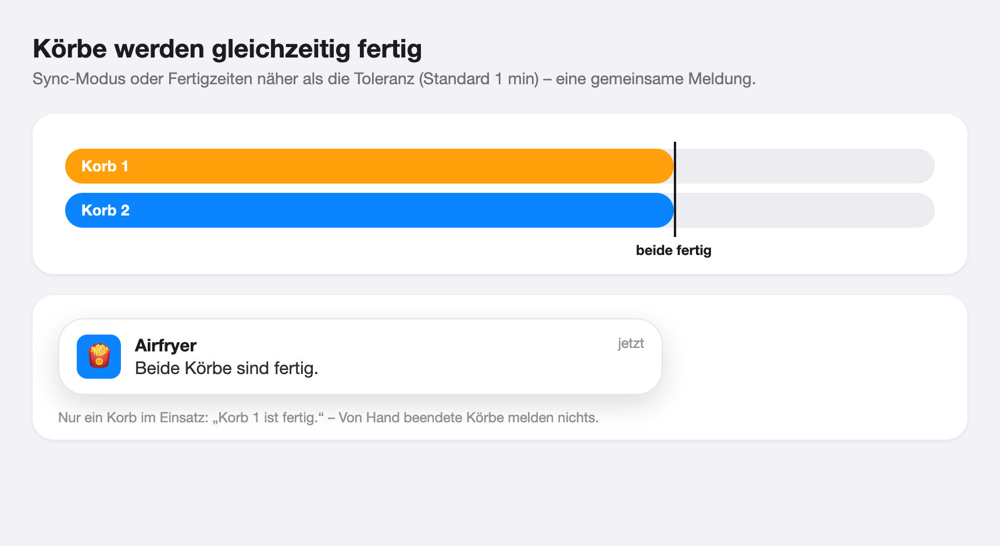 | 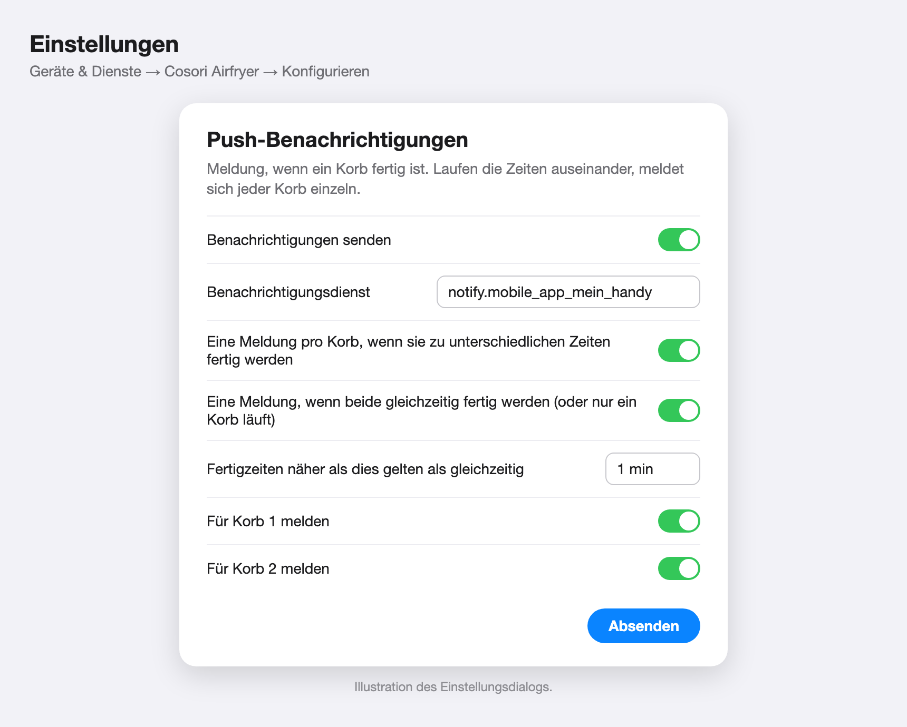 |

*Illustrationen der Meldungen und des Dialogs (Beispieltexte der Integration).*

### Live-Aktivität auf dem Sperrbildschirm

Mit **„Live-Aktivität auf dem Sperrbildschirm“** in denselben Einstellungen zeigt das iPhone (iOS 17.2+, HA-App mit Live-Aktivitäten) bzw. Android 16 während des Garens eine Live-Aktivität:

- **pro Korb** eine eigene, bei **Sync, Match oder ganzem Korb** eine gemeinsame („Korb 1 + 2“)
- **Countdown** bis „fertig um“ und **Fortschrittsbalken**; pausiert sie (z. B. Korb raus), stehen dort Programm, Temperatur und Status (iOS zeigt während des Countdowns nur die Zeit)
- am Ende wird sie **grün mit Ton** („Korb 1 ist fertig. Korb 2 läuft noch 20 min.“) und verschwindet nach 10 Minuten; diese Meldung ersetzt dann die normale Push-Meldung
- von Hand beendet → sie verschwindet sofort

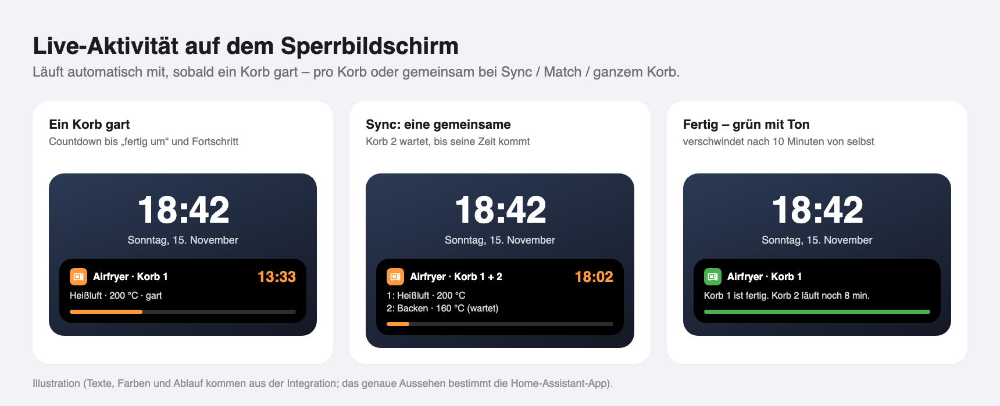

Ziel ist der Benachrichtigungsdienst von oben; er muss ein Notify-Dienst der Home-Assistant-App sein (`notify.mobile_app_…` oder eine Notify-Gruppe aus solchen). Aktualisiert wird nur bei Änderungen bzw. höchstens einmal pro Minute für den Balken – iOS drosselt häufigere Updates.

## Dashboard-Karte

Die Integration bringt eine eigene Karte mit (wird automatisch geladen, keine Ressource nötig): das Foto der TwinFry mit live überlagertem Bedienfeld.

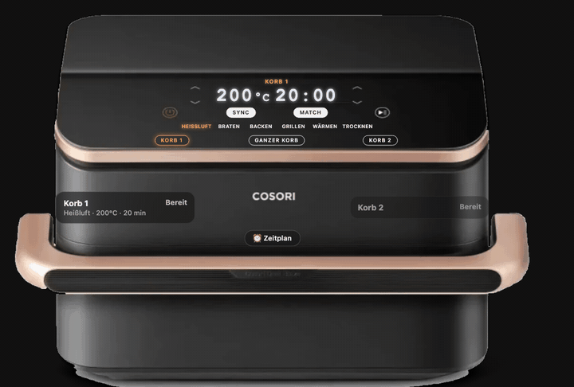

```yaml
type: custom:cosori-airfryer-card
# device_id: …   # optional, sonst die erste Cosori-Fritteuse
```

- **Display** zeigt beim Garen Temperatur und Restzeit (läuft sekündlich mit), sonst die Start-Einstellungen.
- **Pfeile** links/rechts: Temperatur bzw. Garzeit ändern.
- **Programme** (Heißluft … Trocknen) antippen = Programm wählen.
- **KORB 1 / GANZER KORB / KORB 2** = Korb wählen (Pfeile und Programme gelten für diesen Korb); ein garender Korb leuchtet.
- **SYNC / MATCH** wie am Gerät ein- und ausschalten (nochmal tippen = aus).
- **⏰ Zeitplan** auf der Schublade: Start- oder Fertig-Zeit wählen und planen; ist ein Start geplant, zeigt die Taste „Startet morgen 09:00“.
- **▶︎** startet (zweimal tippen zur Bestätigung), während des Garens beendet er den gewählten Korb. **⏻** beendet alles (zweimal tippen).
- Auf der Schublade: Status, Restzeit, Fortschritt und „fertig um“ je Korb; antippen öffnet die Details.
- Ist die Karte schmaler als 640 px (z. B. Handy oder Spaltenansicht), öffnet ein Tipp aufs Bild eine große Bedienansicht mit herangezoomtem Bedienfeld.

| Bereit (Einstellungen pro Korb) | Start planen | Handy |
|---|---|---|
| 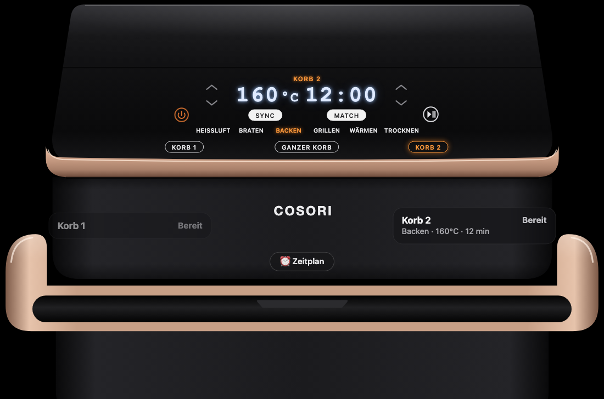 | 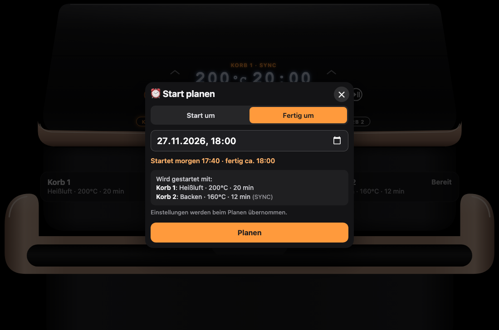 | 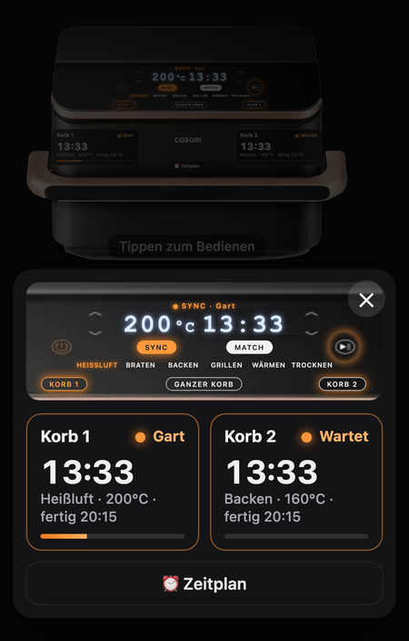 |

## Dienste

```yaml
action: cosori_airfryer.start_cooking
data:
  device_id: <Gerät>
  chamber: chamber_2      # chamber_1 | chamber_2 | whole | both
  mode: airfry            # airfry | roast | bake | grill | reheat | dry
  temperature: 190        # °C, wird auf die Programmgrenzen begrenzt
  duration: 15            # Minuten
```

```yaml
action: cosori_airfryer.end_cooking
data:
  device_id: <Gerät>
  chamber: both           # beendet alles
```

Beispiel-Benachrichtigung, wenn Korb 1 fertig ist:

```yaml
triggers:
  - trigger: state
    entity_id: sensor.airfryer_korb_1_status
    to: cook_end
actions:
  - action: notify.notify
    data:
      message: Korb 1 ist fertig.
```

Beispiel: beide Körbe gleichzeitig mit denselben Einstellungen starten:

```yaml
action: cosori_airfryer.start_cooking
data:
  device_id: <Gerät>
  chamber: both
  mode: airfry
  temperature: 200
  duration: 20
```

Beispiel: Start so planen, dass das Essen um 18:30 fertig ist:

```yaml
action: cosori_airfryer.schedule_start
data:
  device_id: <Gerät>
  time: "2026-12-24 18:30:00"
  type: finish
```

## Fehlersuche

| Problem | Lösung |
|---|---|
| Anmeldung schlägt fehl | E-Mail/Passwort aus der VeSync-App verwenden, Ländercode prüfen (`DE`, `US` …). |
| Entitäten „nicht verfügbar“ | `binary_sensor.…_cloud_verbindung` prüfen – die Fritteuse muss in der VeSync-App online sein. |
| Werte hinken hinterher | Cloud-Polling: 15 s beim Garen, sonst 60 s. Das ist so gewollt. |
| Keine Push-Meldung | In den Optionen „Benachrichtigungen senden“ einschalten und einen `notify.mobile_app_…`-Dienst eintragen. |

## Lizenz

MIT – siehe [LICENSE](LICENSE). Kein offizielles Cosori- oder VeSync-Projekt.
