# Cosori Airfryer for Home Assistant

**English** · [Deutsch](README.de.md)

[](https://hacs.xyz)

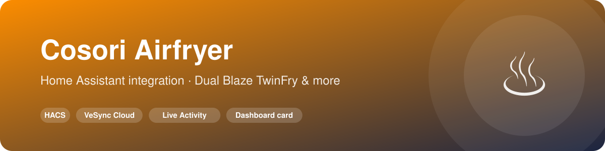

Integration for Cosori air fryers from the **VeSync app**. It was built and tested for the **Cosori Dual Blaze TwinFry 10 L (CAF-TF101S)** with two baskets. Other Cosori air fryers that [pyvesync](https://github.com/webdjoe/pyvesync) supports (CAF-TF102S, Turbo Tower Pro CAF-DC111S, CS137/CS158, CS358, TurboBlaze, Dual Blaze) work with the same integration and get their own drawing in the dashboard card.

> The air fryer has no local interface; it only talks to the VeSync cloud. The integration therefore uses your VeSync account (cloud polling: every 15 s while cooking, otherwise every 60 s).

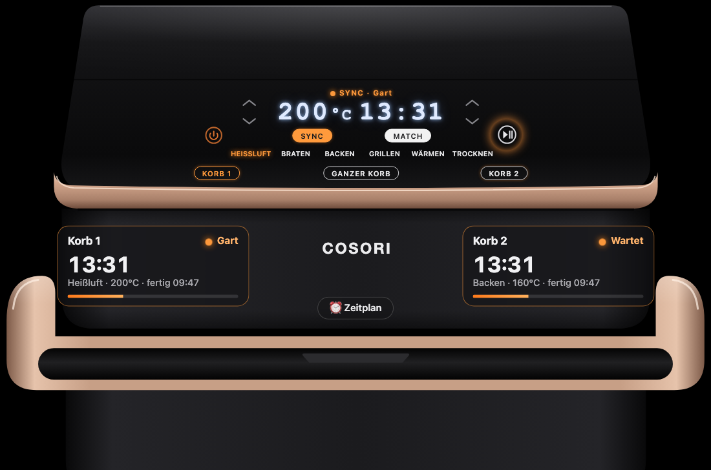

## Video

[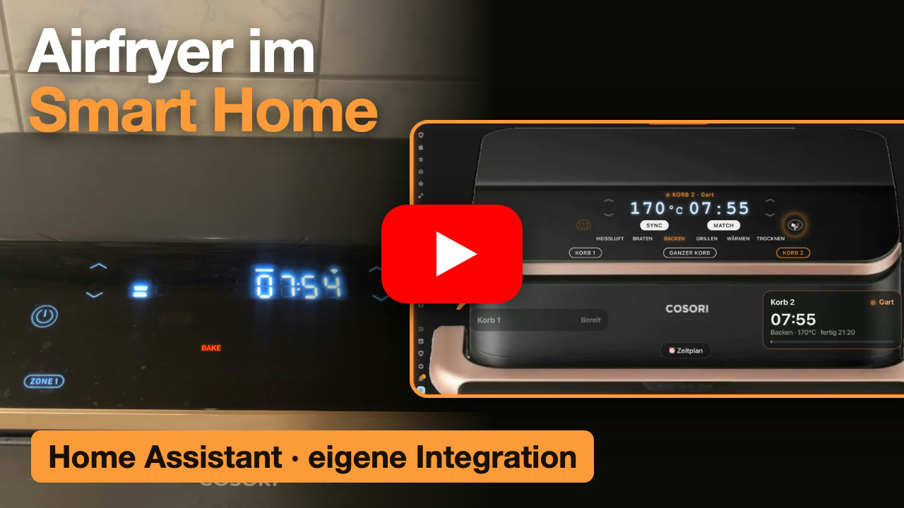](https://youtu.be/GIRd9z8hS3Y)

▶ **[Watch the video on YouTube](https://youtu.be/GIRd9z8hS3Y)** (German, 5 min – YouTube can auto-translate the subtitles): setup, dashboard card, Sync & Match, schedule and Live Activity on real hardware. · [Short (45 s)](https://youtube.com/shorts/IZ2gLCG4rW4)

## How it works

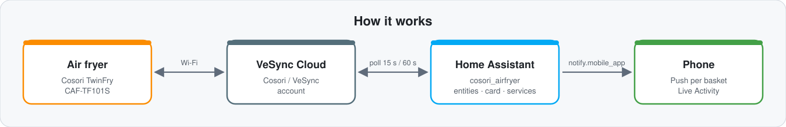

## Contents

- [Video](#video) · [Setup](#setup) · [Entities](#entities-twinfry) · [Schedule](#schedule-start-later) · [Push & Live Activity](#push-notifications-per-basket) · [Dashboard card](#dashboard-card) · [Services & examples](#services) · [Troubleshooting](#troubleshooting)

## Setup

1. HACS → Custom repositories → add `https://github.com/dr-apple/ha-cosori-airfryer` (type *Integration*) and install it.
2. Restart Home Assistant.
3. Settings → Devices & services → *Add integration* → **Cosori Airfryer**, sign in with the e-mail and password of your VeSync app (country code e.g. `DE`, `US`).

## Entities (TwinFry)

| Entity | Description |
|---|---|
| `sensor.…_korb_1_status` / `korb_2_status` | Ready, cooking, paused, basket pulled out, done, waiting (Sync) … |
| `sensor.…_korb_N_restzeit` | Remaining time (incl. Sync waiting time) |
| `sensor.…_korb_N_fertig_um` | Time of day the basket will be done |
| `sensor.…_korb_N_programm` | Air fry, roast, bake, grill, reheat, dry |
| `sensor.…_korb_N_solltemperatur` / `eingestellte_garzeit` | Current setting |
| `binary_sensor.…_korb_N_gart` | On while the basket is heating/cooking |
| `sensor.…_aktiver_korb` | Basket 1, basket 2, whole basket, both (Sync) |
| `binary_sensor.…_cloud_verbindung` | Air fryer online in the VeSync cloud |
| `select.…_start_korb` ("Basket") | Basket being edited/started: basket 1 (left), basket 2 (right), whole basket |
| `select.…_start_programm` / `number.…_start_temperatur` / `number.…_start_garzeit` | Settings **of the selected basket** (each basket keeps its own, they survive restarts); changing the program loads the app's default values |
| `switch.…_sync` | **Sync**: each basket with its own settings, both finish at the same time |
| `switch.…_match` | **Match**: basket 2 copies the settings of basket 1 |
| `button.…_garen_starten` | Starts cooking with the settings above |
| `button.…_korb_1_beenden` / `korb_2_beenden` / `alles_beenden` | Ends cooking |

The entity IDs shown are the ones created with a German Home Assistant; the friendly names follow your Home Assistant language.

Programs and limits of the CAF-TF101S:

| Program | Temperature | Time |
|---|---|---|
| Air fry (`airfry`) | 120–205 °C | 1–60 min |
| Roast (`roast`) | 120–205 °C | 1–240 min |
| Bake (`bake`) | 80–205 °C | 1–240 min |
| Grill (`grill`) | 205–240 °C | 1–30 min |
| Reheat (`reheat`) | 40–205 °C | 1–60 min |
| Dry (`dry`) | 35–95 °C | 30 min–48 h (30-min steps) |

The TwinFry cannot be paused through the cloud – pulling a basket out pauses it, pushing it back in resumes (status "basket pulled out").
Without Sync/Match, "Start cooking" only starts the selected basket. Sync and Match use the same `startMultiCook` command that pyvesync verified on the CAF-DC111S; the integration enables it for the TwinFry.

## Schedule (start later)

The TwinFry has no start time in the cloud API, so Home Assistant schedules the start:

| Entity | Description |
|---|---|
| `datetime.…_geplante_zeit` | Time of the plan (default: next day 09:00) |
| `select.…_geplante_zeit_ist` | **Start time** or **finish time** (the cooking time is then subtracted) |
| `switch.…_zeitplan_aktiv` | Turn on = schedule; the current settings (basket, program, Sync/Match …) are frozen |
| `sensor.…_geplanter_start` | When it will actually start |

The plan survives restarts. If HA misses the start by more than 10 minutes, it is discarded and a notification is created. Services: `cosori_airfryer.schedule_start` (`time`, `type: start|finish`) and `cosori_airfryer.cancel_schedule`.

> Choose food that can safely wait in the basket for hours (cold chain).

## Push notifications per basket

*Settings → Devices & services → Cosori Airfryer → Configure.* Everything is set there (including the [Live Activity](#live-activity-on-the-lock-screen)):

| Option | Meaning |
|---|---|
| Send notifications | Main switch (default: off) |
| Notification service | e.g. `notify.mobile_app_my_phone` or a notify group; empty = notification in the HA sidebar |
| One message per basket … | If the baskets finish at **different times**, each basket reports separately ("Basket 1 is done. Basket 2 still needs 20 min.") |
| One message when both finish together | One combined message ("Both baskets are done."), also if only one basket was used |
| Tolerance (min) | Finish times closer than this count as simultaneous (default 1) |
| Notify for basket 1 / basket 2 | Can be turned off per basket |

Baskets ended by hand ("end" button) do not send a message. The TwinFry has one shared drawer for both baskets: pulling it out reports "basket out" also for a basket that is not cooking – this is ignored. Texts are German or English, depending on the HA language.

| Times differ | Done together | Options |
|---|---|---|
| 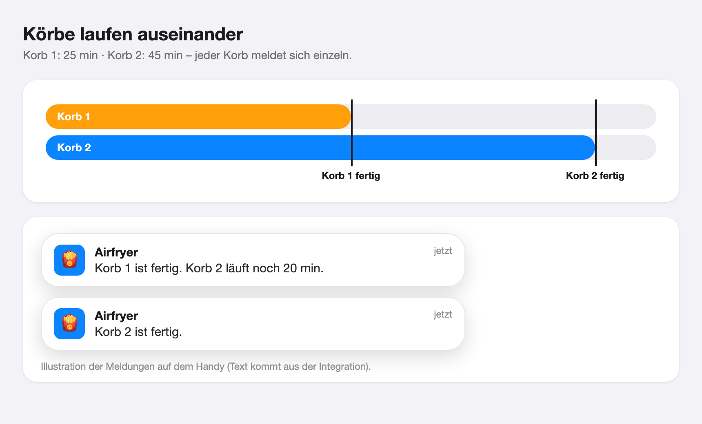 | 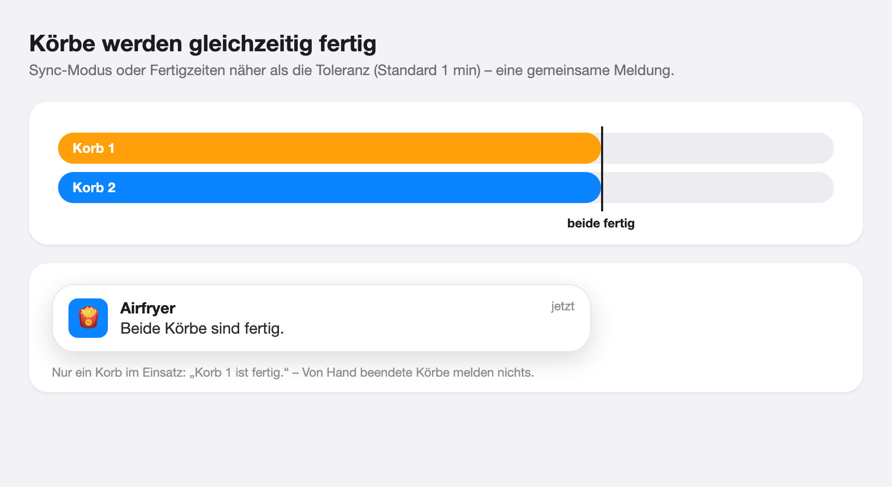 | 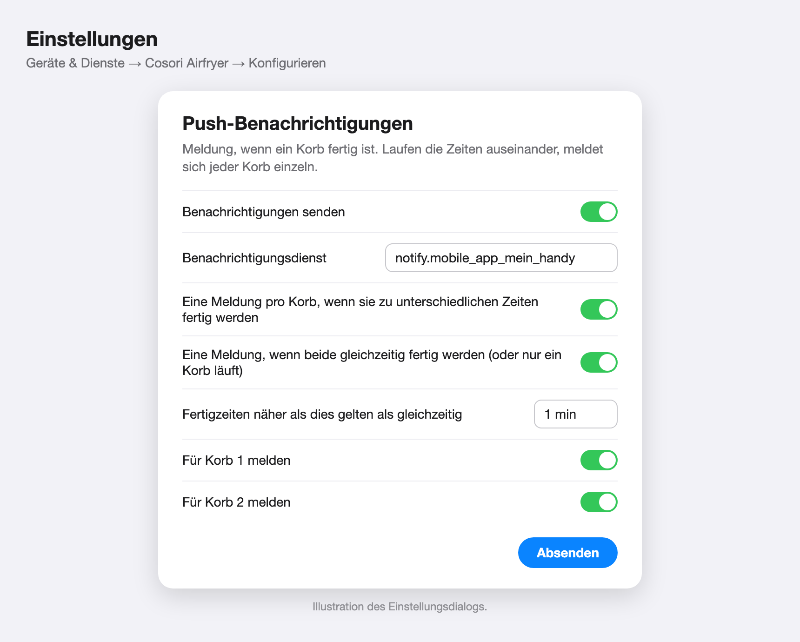 |

*Illustrations of the messages and the dialog (sample texts of the integration, German UI).*

### Live Activity on the lock screen

With **"Live Activity on the lock screen"** in the same options, the iPhone (iOS 17.2+, HA app with Live Activities) or Android 16 shows a Live Activity while cooking:

- **one per basket**; with **Sync, Match or whole basket** one shared activity ("Basket 1 + 2")
- **countdown** to the finish time and a **progress bar**; while paused (e.g. basket out) it shows program, temperature and status (during the countdown iOS shows only the time)
- at the end it turns **green with a sound** ("Basket 1 is done. Basket 2 still needs 20 min.") and disappears after 10 minutes; this replaces the normal push message
- ended by hand → it disappears immediately

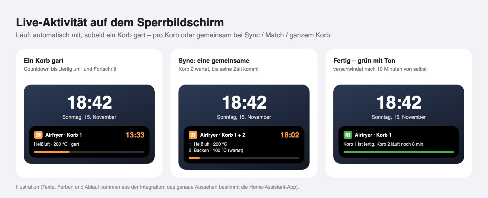

The target is the notification service from above; it must be a notify service of the Home Assistant app (`notify.mobile_app_…` or a notify group of those). Updates are only sent on changes, or at most once per minute for the progress bar – iOS throttles more frequent updates.

## Dashboard card

The integration ships its own card (loaded automatically, no resource needed): a drawing of your air fryer with a live control panel overlaid. The model is detected automatically; every air fryer that pyvesync supports has its own drawing:

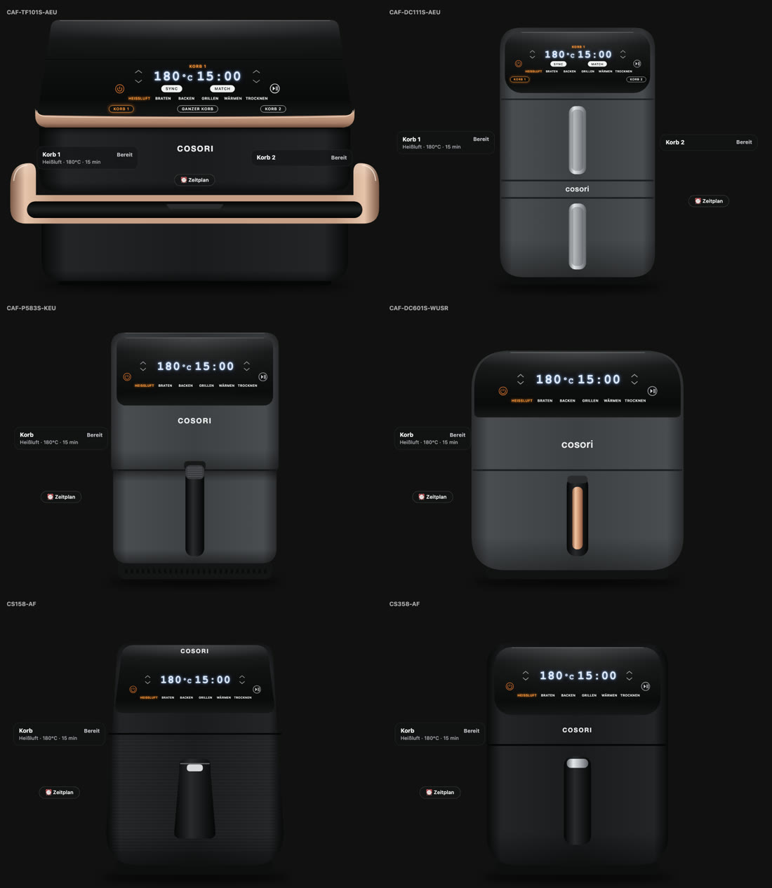

| Drawing (`model:`) | Models |
|---|---|
| `twinfry` | Dual Blaze TwinFry CAF-TF101S, CAF-TF102S (two baskets, whole basket) |
| `turbotower` | Turbo Tower Pro CAF-DC111S (two drawers stacked) |
| `dualblaze` | Dual Blaze 6.8 Qt CAF-P583S |
| `turboblaze` | TurboBlaze 6 Qt CAF-DC601S |
| `cs158` | Smart / Pro / Pro Gen 2 5.8 Qt CS158, CS137 (and CS159/168/169) |
| `cs358` | Pro II 5.8 Qt CS358 |

On air fryers with one basket the basket, Sync and Match buttons are hidden. All drawings are my own artwork (no manufacturer photos).

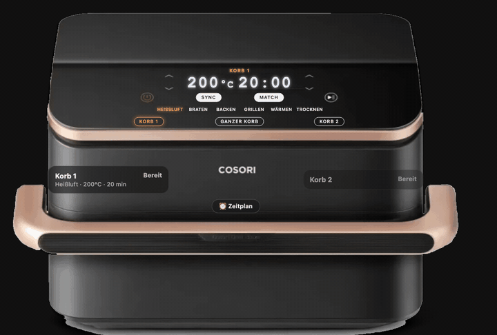

```yaml
type: custom:cosori-airfryer-card
# device_id: …   # optional, otherwise the first Cosori air fryer
# model: turbotower   # optional, otherwise detected from the device
# image: /local/my-fryer.jpg   # optional own picture (front view, 4:3)
```

All options can also be set in the card editor (device, model, own picture).

- **Display** shows temperature and remaining time while cooking (ticks every second), otherwise the start settings.
- **Arrows** left/right: change temperature or cooking time.
- **Programs** (air fry … dry): tap to select.
- **BASKET 1 / WHOLE BASKET / BASKET 2** select the basket (arrows and programs apply to it); a cooking basket lights up.
- **SYNC / MATCH** toggle like on the device (tap again = off).
- **⏰ Schedule** on the drawer: pick a start or finish time and schedule; with a scheduled start the button shows e.g. "Starts tomorrow 09:00".
- **▶︎** starts (tap twice to confirm); while cooking it ends the selected basket. **⏻** ends everything (tap twice).
- On the drawer: status, remaining time, progress and finish time per basket; tap to open the details.
- If the card is narrower than 640 px (phone or column view), tapping the picture opens a large control view with a zoomed-in panel.

| Ready (settings per basket) | Schedule a start | Phone |
|---|---|---|
| 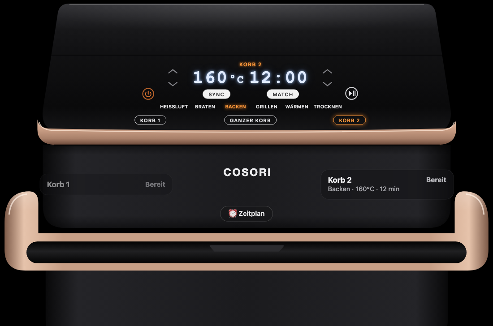 | 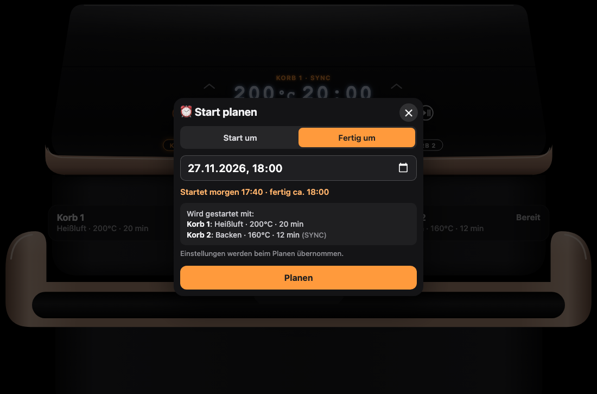 | 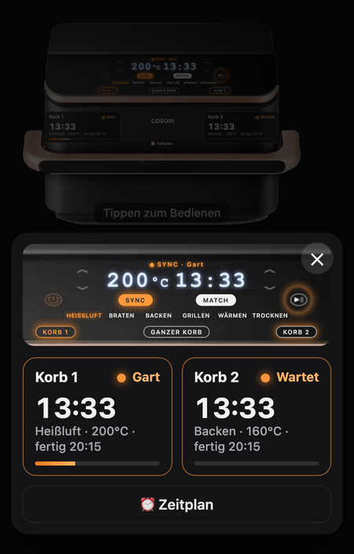 |

## Services

```yaml
action: cosori_airfryer.start_cooking
data:
  device_id: <device>
  chamber: chamber_2      # chamber_1 | chamber_2 | whole | both
  mode: airfry            # airfry | roast | bake | grill | reheat | dry
  temperature: 190        # °C, clamped to the program limits
  duration: 15            # minutes
```

```yaml
action: cosori_airfryer.end_cooking
data:
  device_id: <device>
  chamber: both           # ends everything
```

Schedule a start so that dinner is ready at 18:30:

```yaml
action: cosori_airfryer.schedule_start
data:
  device_id: <device>
  time: "2026-12-24 18:30:00"
  type: finish            # start | finish
```

Example automation – notify when basket 1 is done:

```yaml
triggers:
  - trigger: state
    entity_id: sensor.airfryer_korb_1_status
    to: cook_end
actions:
  - action: notify.notify
    data:
      message: Basket 1 is done.
```

## Troubleshooting

| Problem | Fix |
|---|---|
| Login fails | Use the e-mail/password of the VeSync app and check the country code (`DE`, `US` …). |
| Entities "unavailable" | Check `binary_sensor.…_cloud_verbindung` – the air fryer must be online in the VeSync app. |
| Values lag behind | Cloud polling: 15 s while cooking, 60 s otherwise. This is intentional. |
| No push message | Turn on "Send notifications" in the options and enter a `notify.mobile_app_…` service. |

## License

MIT – see [LICENSE](LICENSE). Not an official Cosori or VeSync project.
